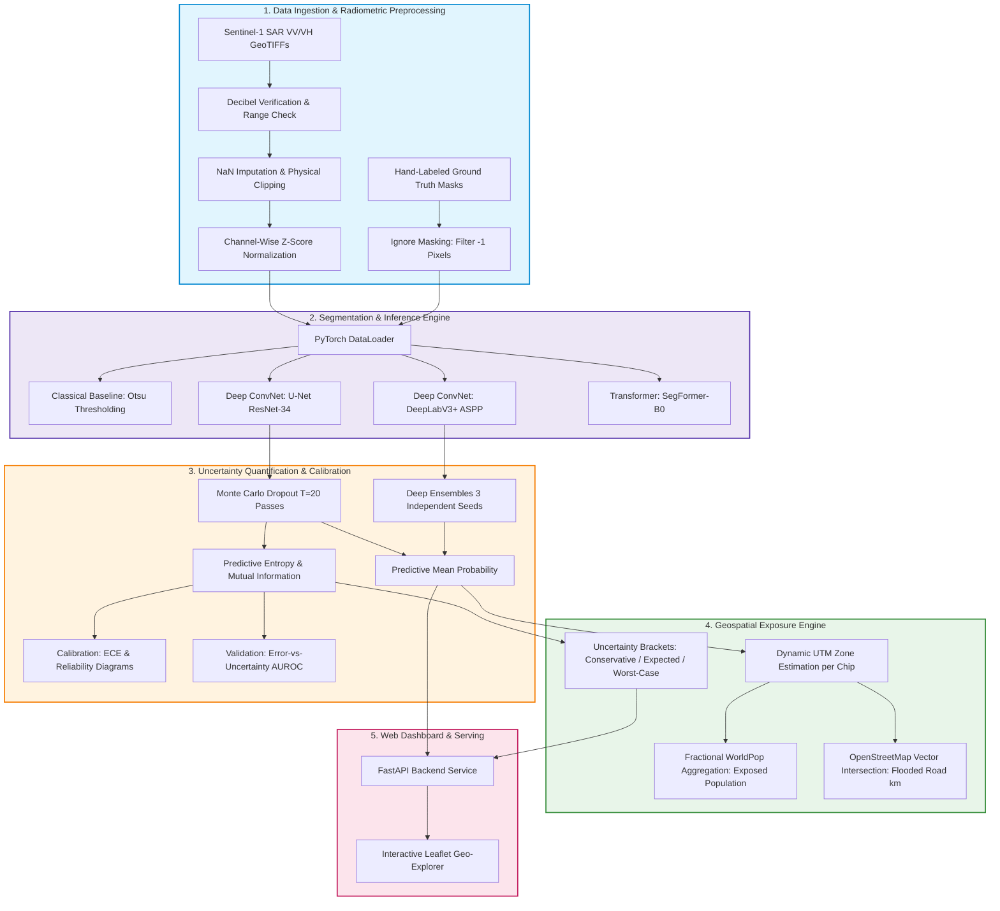
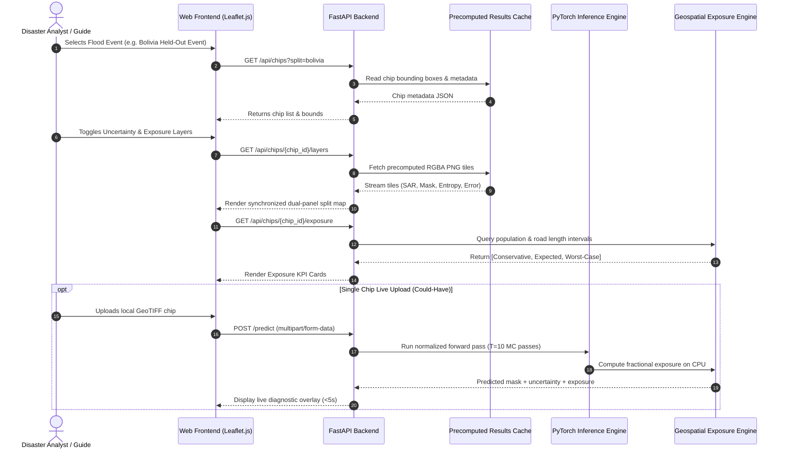
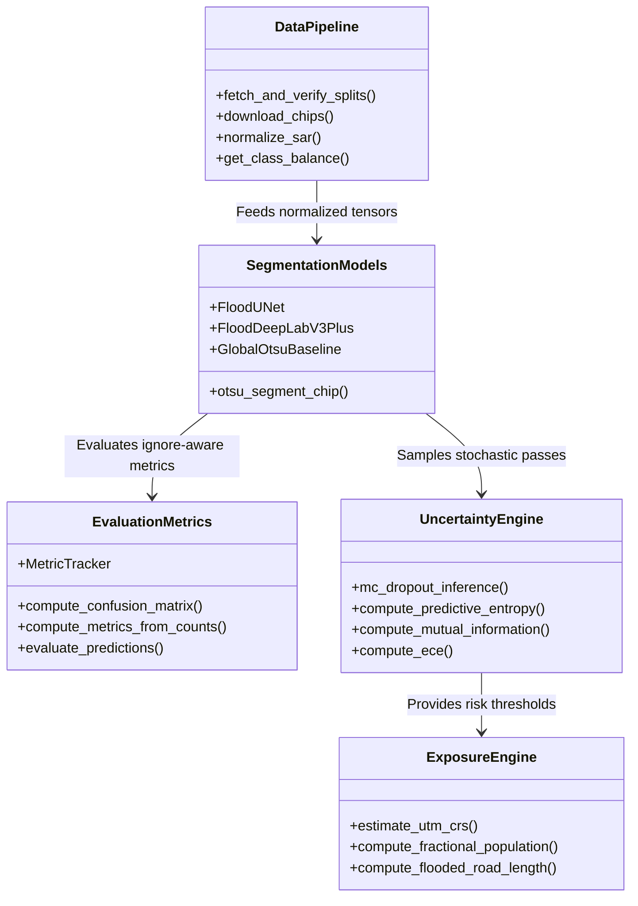

# System Architecture & Technical Specifications

**Course:** B.M.S. College of Engineering, UG CSE 5th-Semester Mini-Project  
**Title:** Uncertainty-Aware Flood Extent Mapping from Sentinel-1 SAR with Cross-Region Evaluation and Exposure Estimation  
**Anchor Milestone:** Review-2 (Design with Basic Module Implementation)

---

## 1. End-to-End System Architecture

---

## 2. Complete Data Flow Diagram

---

## 3. Module Boundaries & Engineering Responsibilities

